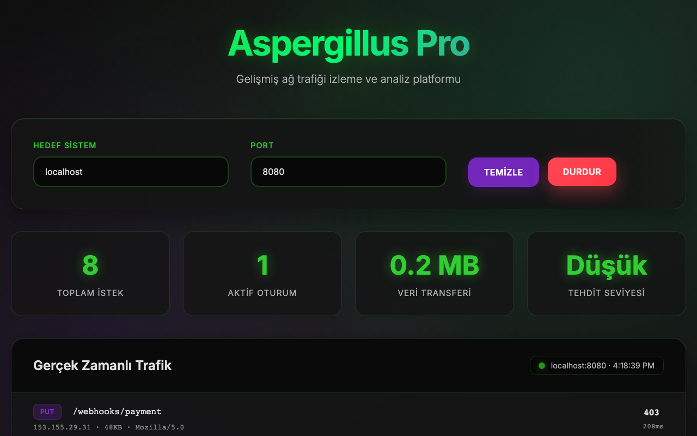

# Aspergillus Pro

A prototype of a network-traffic dashboard. It has two parts that are not joined yet: a standalone page that plays simulated traffic, and a FastAPI server with a status API and its own dashboard page.

**Nothing is captured from the network yet.** The numbers on both pages are either simulated or zero.



## Open the standalone page

```bash
git clone https://github.com/kocayinsec/aspergillus-pro.io.git
cd aspergillus-pro.io
open dashboard.html
```

Press **BAŞLAT** (start). The requests, sessions and threat level are generated in the browser. The interface is in Turkish.

## Run the server

```bash
python3 -m venv .venv
source .venv/bin/activate
pip install -r requirements.txt
python run_dashboard.py
```

It serves on http://127.0.0.1:8000 and opens that address in your browser. The page connects over a WebSocket and shows the server's state. Its counters stay at zero, because the monitoring loop is not fed any packets.

| Endpoint | Answers with |
| --- | --- |
| `GET /api/status` | running state and uptime |
| `GET /api/stats` | counters |
| `GET /api/threats` | stored alerts, an empty list for now |
| `GET /api/config` | interface and thresholds |
| `POST /api/monitoring/start`, `/stop` | starts and stops the monitoring loop |

Checked on Python 3.13 (macOS), 11 November 2026.

## Written but not connected

- `src/packet_analyzer.py` captures packets with Scapy, and `src/threat_detector.py` looks for port scans, brute force and floods. The server builds both and never passes packets to them.
- `src/api_integrations.py` (VirusTotal and AbuseIPDB lookups), `src/email_notifier.py` and `src/reporting.py` are not reached for the same reason.
- `Dockerfile` and `docker-compose.yml` have not been checked.
- `aspergillus-pro.html` is an earlier version of the standalone page.
- There are no automated tests.

Capturing packets needs elevated privileges. Monitor only networks you are allowed to monitor.

## License

[MIT](LICENSE)
